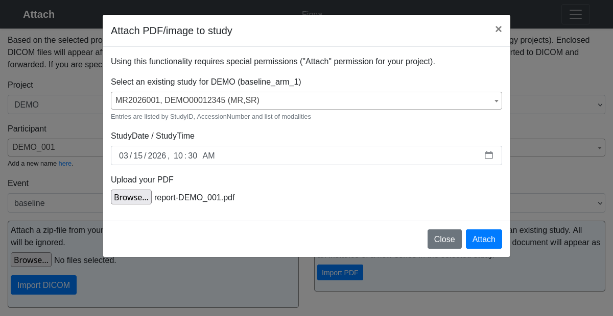

.. _attach-pdf-guide:

Attach PDF
==========

The Attach application can add a PDF report or a JPEG image to an existing study in the research PACS. Each page of the PDF document becomes one image in a new series of the selected study. No Assign step is needed.

.. figure:: ../../_static/attach-pdf-1.png
   :width: 100%

   Attach web application. Project, participant and event are selected; the "Import PDF" button is active.

Access
------

You need to be logged in, with Attach permission for the project. The "Import PDF" button is visible only after login.

Steps
-----

1. Select the project. The "Import PDF" button becomes active.
2. Select the participant and the event.
3. Click "Import PDF". The window "Attach PDF/image to study" opens.
4. Select the study from the list "Select an existing study". Entries show StudyID, AccessionNumber and the list of modalities. StudyDate and StudyTime are filled in from the selected study.
5. Select one PDF or JPEG file.
6. Click "Attach".

   The window "Attach PDF/image to study" with a selected study and a PDF file.

Result
------

- The PDF or JPEG appears in the selected study as a new series (modality OT). This can take a few minutes.
- The study keeps its AccessionNumber, StudyID and StudyInstanceUID.

..
   TODO: add the screenshot from the research PACS when available:

   .. figure:: ../../_static/attach-pdf-3.png
      :width: 100%

      The attached PDF as a new series in the existing study in the research PACS.

.. note::

   Only one file can be attached at a time. Only PDF and JPEG files are accepted.
