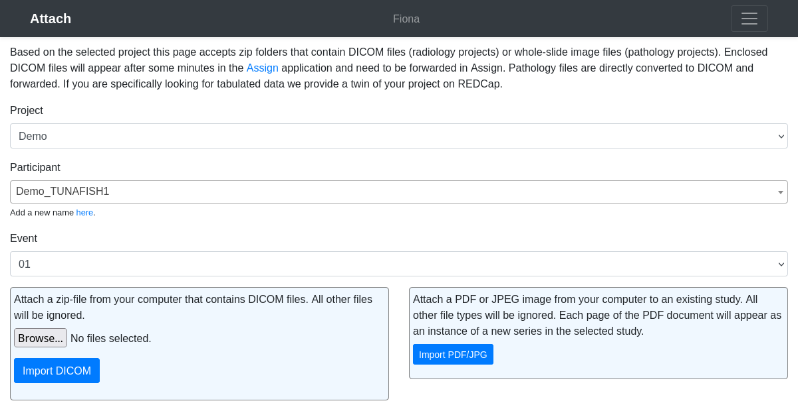
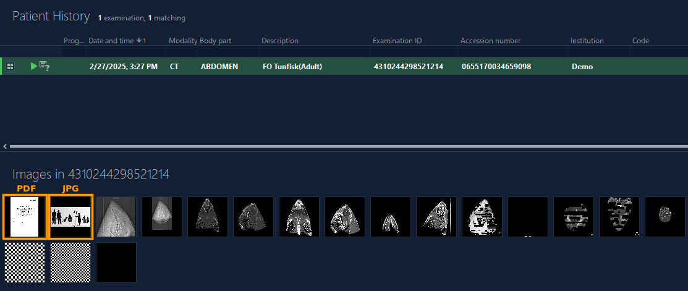

:tocdepth: 1

.. _attach-pdf-guide:

Attach PDF/JPG
==============

.. raw:: latex

   \sphinxsetup{bookmarksdepth=2}

The Attach application can add a PDF file or a JPEG image to an existing study in the research PACS. Each page of the PDF document becomes one image in a new series of the selected study. No Assign step is needed.

   Attach web application. Project, participant and event are selected; the "Import PDF/JPG" button is active.

Access
------

You need to be logged in, with Attach permission for the project. The "Import PDF/JPG" button is visible only after login.

Steps
-----

1. Select the project. The "Import PDF/JPG" button becomes active.
2. Select the participant and the event.
3. Click "Import PDF/JPG". The window "Attach PDF/JPG to study" opens.
4. Select the study from the list "Select an existing study". Entries show StudyID, AccessionNumber and the list of modalities. StudyDate and StudyTime are filled in from the selected study.
5. Select one PDF or JPEG file.
6. Click "Attach".

.. figure:: ../../_static/attach-pdf-2.png
   :width: 70%

   The window "Attach PDF/JPG to study" with a selected study.

Result
------

- The PDF or JPEG appears in the selected study as a new series (modality OT). This can take a few minutes.
- The attached file appears automatically. No Assign step is needed.
- The study keeps its AccessionNumber, StudyID and StudyInstanceUID.

   Patient History in the research PACS. The study keeps its Examination ID and Accession number. The attached PDF page and JPEG image (marked in orange) are the first two images, next to the original CT images.

.. note::

   Only one file can be attached at a time. Only PDF and JPEG files are accepted.

.. raw:: latex

   \sphinxsetup{bookmarksdepth=5}
