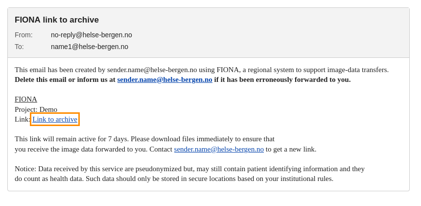

:tocdepth: 2

.. _export-guide:

Export
======

.. raw:: latex

   \sphinxsetup{bookmarksdepth=3}

Secure download (email)
-----------------------

The Export application can send a study as a password-protected archive to one or more e-mail addresses. The recipients get a download link and, in a separate e-mail, the password.

Steps
^^^^^

1. Select the project and the export format.
2. In the row of the study, open the menu and click "Secure download (email)". The window for a secure download opens.

   .. figure:: ../../_static/export-email-1.png
      :width: 100%

      The menu of a study row. "Secure download (email)" is marked in orange.

3. A random 12-character password is already filled in. You can keep it, enter your own password, or click "generate" to create a new random password.
4. Enter the e-mail address of the recipient. To send to several recipients, separate the addresses with a semicolon (;) or a comma (,), for example ``name1@helse-bergen.no;name2@ihelse.net``. All addresses must belong to Helse Bergen (ending with @helse-bergen.no or @ihelse.net).
5. Click "Send as email".

   .. figure:: ../../_static/export-email-2.png
      :width: 60%

      The window "Secure download link" with a generated password and two recipients. The "Send as email" button is marked in orange.

Result
^^^^^^

- The export is added to the download queue, the same queue as used by "Prepare". When the archive is ready, each recipient gets two e-mails from no-reply@helse-bergen.no:

  - "FIONA link to archive": the project name, a link to the archive and your e-mail address as the contact person.
  - "no-reply", about 15 seconds later: the password only.

   The first e-mail, "FIONA link to archive". The link to the archive is marked in orange.

.. figure:: ../../_static/export-email-4.png
   :width: 90%

   The second e-mail, "no-reply". The password is marked in orange.

- The archive is a 7z file encrypted with the password. File names inside the archive are also hidden.
- The recipient must log in to Fiona to download the archive.
- The link is active for 7 days. If it has expired, the recipient should contact you for a new link.
- To open the 7z file, the recipient needs a program that supports 7z archives, for example 7-Zip. Ask your IT department to install it.

.. note::

   Only e-mail addresses ending with @helse-bergen.no or @ihelse.net are accepted. If any address is not accepted, no e-mail is sent to any recipient and no error message is shown.

.. note::

   The data is pseudonymized but counts as health data. Store it only in secure locations.

.. raw:: latex

   \sphinxsetup{bookmarksdepth=5}
